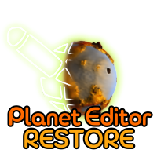

  

# PlanetEditor-Restore

Mod that brings back the Planet Editor from the Feb 2008 build with all, or at least stable, tools.

This is a test mod to see how flexible Spore can be in terms of creating/porting global editors with all the changes to make 'em appear in-game and in the stages stably.

# Requirements.

1. Spore ModAPI Launcher;
2. Spore GA;
3. Straight hands.

# What's the deal?

The point of the mod is to give players the ability to create planets not just for adventures, but for full-on gameplay, like it was originally intended.

With this mod, the Planet Editor is a full-fledged part of the editor system, letting you create four types of planets (only four for now. Support for vanilla without GA is coming closer to release):
1. Planet - standard planet for colonization;
2. Mission Planet - planet with the ability to create 2 missions: derelict ship, ruined civilization;
3. Homeworld - starting planet you can actually play on (SERIOUS BUGS MIGHT POP UP WHILE PLAYING ON THESE. USE AT YOUR OWN RISK);
4. Template Planet - templates for the Adventure Editor.

# Plans for the future.

Right now I'm polishing the UI and adding separate UI selection via .sporemod instead of through the debug menu in options.
After the UI I wanna do and polish the following:
1. Adding rings, making for some dope-looking planet types;
2. Stable terrain changes when swapping terrain indices or similar tools in the Space Stage;
3. The ability to create gas giants (right now this is more on the concept side and probably won't be done even after release);
4. Easy adding of custom brushes for making add-ons;
5. Randomizer for rock placement, as well as ruined cities;
6. Ability to rotate the camera from the surface, not just from the planet itself.

# The saddest part rn.

No source code will be available during development.
But! After the first full release I'll drop the source code and update it every time, even when I'm tweaking stuff outside of releases.
